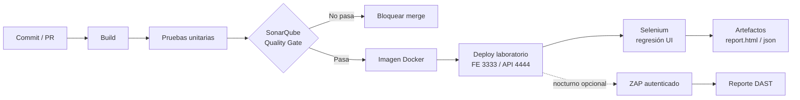

# EV56-21 — Diagrama CI/CD con controles de seguridad (borrador)

**Autores borrador:** Giannina (Ninna) · completar con Skarlett  
**Uso:** sección 6.3 del informe EP5 + lámina 10 del guion EP6  
**Estado:** esquema; Skarlett ajusta herramientas reales del equipo

## Idea principal

El pipeline debe frenar un cambio inseguro **antes** de que llegue al laboratorio estable, y después verificar UI y (si alcanza) DAST.

## Diagrama (Mermaid)

## Controles por etapa

| Etapa | Control | Norma / estándar de apoyo | Dueño sugerido |
|-------|---------|---------------------------|----------------|
| PR / commit | Revisión + secretos fuera del repo (INC-02) | 27001 (secretos) | Nicolás |
| Unitarias | Regresión mínima auth/RBAC | 29119 (proceso) | Nicolás |
| Sonar Quality Gate | Bugs / vulnerabilidades / smells | 25010 mantenibilidad + SAST | Skarlett |
| Imagen Docker | Build reproducible del lab | Configuración segura | Equipo |
| Selenium | Regresión UI post-merge | IE5 / obligatorio examen | Nicolás |
| ZAP nocturno | DAST autenticado | 27001 / IE1 | Ari |
| Evidencias | Prefijo `EV56-` + path en bitácora | Trazabilidad informe | Ninna integra |

## Qué falta que complete Skarlett

- [ ] Herramientas exactas del equipo (GitHub Actions / otro CI, runner, etc.)
- [ ] Umbrales del Quality Gate (lo que ya usan en Sonar)
- [ ] Si ZAP va en pipeline o solo manual con evidencia
- [ ] Diagrama exportado a PNG/SVG para el PPT

## Nota

No inventar capturas de pipeline. Si el CI aún no está automatizado, el diagrama se presenta como **propuesta de mantenimiento continuo** (IE7) y se declara el estado actual del laboratorio Docker.
