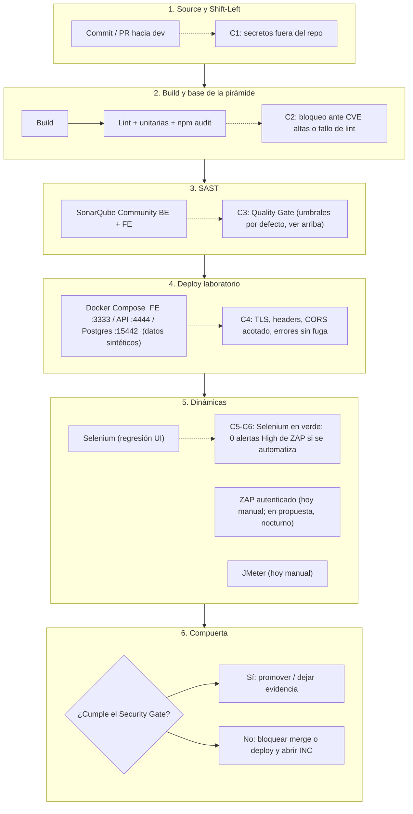

# EV56-21 — Diagrama CI/CD con controles de seguridad

**Autores:** Skarlett Tropan (completa el borrador de Giannina / Ninna)  
**Uso:** informe EP5 §6.3 + lámina 10 del guion EP6  
**Figura:** [`EV56-21-Diagrama-CICD-Controles.png`](./EV56-21-Diagrama-CICD-Controles.png)  
**Borrador de workflow (no activo):** [`EV56-21-security.yml`](./EV56-21-security.yml)  
**Corte:** 27-nov-2026, America/Santiago

## Estado real del repositorio (no inventar pipeline)

Revisé `origin/dev` (`5707693e2f7e9826d645800e89792533329e1b99`) y `origin/main` (`d5829ed3041642df0714fcb8b65b270364ed5d7a`): **no existe** carpeta `.github/workflows/` ni otro CI (Jenkins, GitLab CI, etc.).

Hoy el equipo trabaja así:

| Herramienta | Cómo se usa realmente |
|-------------|------------------------|
| GitHub (`Barrolas/cuidarte-mas`) | Control de versiones y pull requests |
| Docker Compose | Laboratorio local: FE `:3333`, API `:4444`, Postgres `:15442` |
| SonarQube Community 26.11.0.134175 | SAST **manual** en Docker (`localhost:9000`), scanner con `-Dsonar.sources=src` y `-Dsonar.qualitygate.wait=true` |
| Selenium (`pytest` / POM) | Regresión UI a cargo de Nicolás, **manual** |
| OWASP ZAP | DAST a cargo de Ari, **manual** (no corre en un pipeline) |
| JMeter | Estrés a cargo de Ari, **manual** |
| `npm audit` | Pendiente formal (INC-11) |

Por eso este diagrama se presenta como **propuesta de mantenimiento continuo (IE7)**, no como captura de un pipeline que ya esté automatizado. El laboratorio actual sigue siendo Docker local.

## Respuestas al “Qué falta” del borrador de Ninna

1. **Herramientas exactas:** GitHub + runner hipotético `ubuntu-latest` **si** se activa el YAML de propuesta. Hoy no hay runner ni Actions. El laboratorio real es Docker Compose en el equipo.
2. **Umbrales del Quality Gate (los que ya usamos):** Quality Gate **por defecto** de SonarQube Community (“Sonar way”), sin umbrales custom. Cuando el proyecto tiene periodo de *New Code*, las condiciones observadas en las corridas del 25-nov (`sk/inc-06-errores` / refactor) fueron:
   - `new_coverage` ≥ **80 %** (falla si es menor)
   - `new_duplicated_lines_density` ≤ **3 %** (falla si es mayor)
   - `new_violations` ≤ **0**
   En una instancia **fresca** (sin versión previa), el API devolvió `conditions: []` y el Quality Gate quedó **Passed** aunque el backend tuviera calificación de seguridad **E**. Eso ocurrió el 25-nov sobre `dev` `2d0abc7` y el 27-nov sobre `origin/dev` `5707693`.
3. **ZAP en el pipeline:** **no**. Hoy es manual, con evidencia de Ari. En la propuesta aparece como paso opcional / nocturno, no como control que ya esté automatizado.
4. **Exportación PNG:** este mismo archivo, `EV56-21-Diagrama-CICD-Controles.png`.

## Idea principal

El pipeline propuesto debe frenar un cambio inseguro **antes** de que llegue al laboratorio estable (*Shift-Left* / *Fail Fast*) y, después del deploy de lab, verificar UI y (si se automatiza) DAST.

## Diagrama (Mermaid)

## Leyenda de controles (para §6.3 e IE3)

| ID | Etapa | Control / umbral | INC o CP que ataca | Norma de apoyo | Dueño sugerido |
|----|-------|------------------|--------------------|----------------|----------------|
| C1 | PR / commit | Secretos solo en env / GitHub Secrets; sin fallback en código | INC-02; secreto de Postgres en `db.js:6` | 27001 A.5.17 / A.8.24; Ley 19.628 art. 11 | Nicolás |
| C2 | Build | Lint + `npm audit --audit-level=high` | INC-11 | 27001 A.8.8 / A.8.28; 29119 | Nicolás / QA |
| C3 | SAST | Sonar Quality Gate (umbrales reales arriba). El Passed sobre *New Code* o en instancia fresca **no** certifica el producto | INC detectables por SAST; no sustituye retest de INC-01/06/07 | 27001 A.8.25 / A.8.28; ISO 25010 | Skarlett |
| C4 | Lab Docker | IaC reproducible; verificar TLS, headers, CORS y 500 genéricos | CP-14, INC-05, INC-06 / CP-17, INC-16 | 27001 A.8.24 / A.8.31; DS 41 art. 8 | Equipo |
| C5 | ZAP | Hoy manual (Ari). En propuesta: bloquear ante alerta High | INC-07, INC-05, CP-04 | 27001 A.8.29; Ley 20.584 art. 13 | Ari |
| C6 | Selenium / JMeter | Selenium post-merge (obligatorio examen, Nicolás). JMeter manual (Ari) | INC-04, CP-05, CP-19 | 27001 A.8.29; NFR-PERF-1 (p95 ≤ 300 ms) | Nicolás / Ari |
| C7 | Gate | Si falla audit crítico, Quality Gate con *New Code*, Selenium o ZAP High: no promover | Cualquier P0 abierto | 27001 A.8.25 / A.8.32; Ley 21.719 art. 14 quinquies (horizonte 1-dic-2026) | Equipo |
| C8 | Evidencias | Prefijo `EV56-` + path en bitácora | Trazabilidad del informe | DS 41 arts. 9, 11 y 12; Ley 21.663 art. 9 | Ninna integra |

## Métricas objetivo (propuesta; no medidas de un CI real)

1. Tiempo de build + validación base ≤ 15 minutos (cuando exista CI).  
2. Tasa de éxito del pipeline ≥ 95 %.  
3. Cobertura unitaria: hoy **0,0 %** en backend y frontend (Sonar 27-nov); meta evolutiva en el plan de mantenimiento.  
4. MTTR objetivo ≤ 2 horas.  
5. RTO ≤ 15 minutos y RPO ≤ 15 minutos (fichas clínicas), según el plan de mantenimiento.

No hay capturas de un pipeline en verde: no existe aún.
